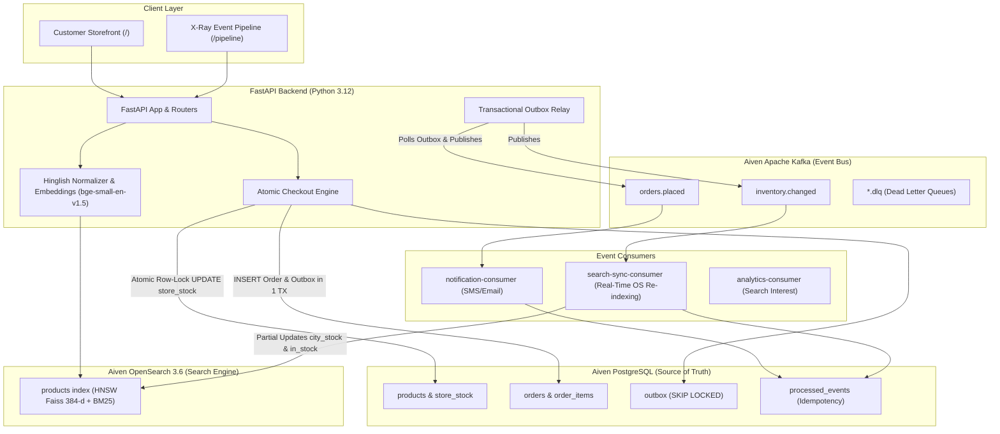
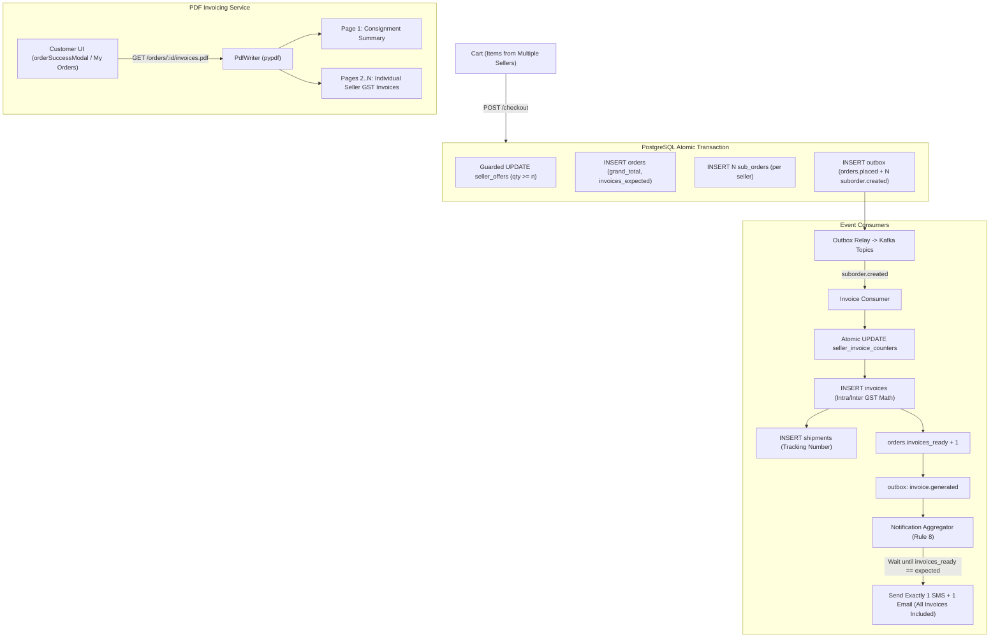

# MyStore 🛍️🇮🇳

> Production-quality, event-driven Indian retail superstore powered by **Aiven managed PostgreSQL, Apache Kafka, and OpenSearch**. Built for high-concurrency atomic checkout, sub-second hybrid search with Hinglish intelligence, and reactive microservices.

---

## 🏗️ System Architecture



---

## ⚡ Core Highlights

1. **Guaranteed Atomic Checkout (No Double-Sell)**
   - Stock deduction executes via:
     ```sql
     UPDATE store_stock SET qty = qty - :n 
     WHERE product_id = :p AND city = :c AND qty >= :n
     ```
   - Rowcount 0 immediately rejects the order with `OutOfStockError`.
   - Order, order items, and outbox rows are committed within **one strict database transaction**.
   - Verified with a 10-buyer concurrent checkout stress test: **1 succeeded, 9 rejected, 0 remaining stock**.

2. **Transactional Outbox & Kafka Event Bus**
   - No dual-write failure: Kafka publishing never happens inside the DB transaction.
   - Background relay worker polls pending outbox entries with `FOR UPDATE SKIP LOCKED`.
   - Idempotent event consumers use the `processed_events` table to ensure exact-once processing semantics.
   - Built-in automatic retries with exponential backoff and routing to Dead Letter Queues (`*.dlq`).

3. **Hybrid Search with Hinglish Understanding**
   - Combines **BM25 full-text** (fuzziness, brand boosting, edge n-gram autocomplete) with **kNN dense vectors** (384-d `BAAI/bge-small-en-v1.5` embeddings).
   - Reciprocal Rank Fusion (RRF) merges lexical and semantic rankings.
   - Curated dictionary translates Hinglish phrases (e.g., `sasta atta` → `cheap flour`, `bata juta` → `bata shoes`, `kam keemat` → `low price`) while safeguarding 70+ Indian brand names from accidental translation.
   - **100% Recall@5** achieved on a benchmark scorecard of 30 realistic Indian retail search queries.

4. **Real-Time X-Ray Pipeline Dashboard (`/pipeline`)**
   - Live Server-Sent Events (SSE) tracking order progression:
     $$\text{Placed} \longrightarrow \text{Outbox Published} \longrightarrow \text{Kafka Consumed} \longrightarrow \text{Search Sync Re-indexed}$$
   - Interactive 10-buyer stress test button with live race condition demonstration.
   - Audit trail of dispatched SMS and Email notifications.

5. **Multi-Seller Marketplace Checkout with Per-Seller GST Invoices**
   - **One Order, One Payment**: Customer places 1 order, pays 1 grand total, receives 1 consolidated SMS and 1 Email.
   - **Legal Compliance**: Generates individual GST Tax Invoices per seller sub-order compliant with Section 31 of CGST Act.
   - **Gap-Free Numbering**: Sequential numbering per seller via atomic `seller_invoice_counters` (`UPDATE ... RETURNING`): `INV-2024-25-{SELLERCODE}-{000001}`.
   - **Place of Supply Tax Rules**: Automatic detection of intra-state (CGST 50% + SGST 50%) vs inter-state (IGST 100%) transactions based on seller state vs delivery state.
   - **Notification Aggregator**: Enforces Rule 8 — notification consumer delays sending confirmation until `invoices_ready == invoices_expected`, embedding every seller's invoice number and tracking link into a single customer notification.
   - **Consolidated PDF Downloads**: `GET /orders/{id}/invoices.pdf` renders an Order Consignment Cover Sheet followed by each seller's full legal Tax Invoice merged into a single multi-page PDF using PyPDF (with 409 Conflict protection while invoices are processing).

6. **Post-Delivery Returns & Reverse Logistics (`/admin/returns`, `/docs/RETURNS.md`)**
   - End-to-end customer return lifecycle: Category return windows (Fashion 10d, Electronics/Mobiles 7d, Beauty 3d), reason validation, multi-photo proof upload, refund, replacement, or size exchange.
   - Concurrency locking with `SELECT ... FOR UPDATE` on `order_items` prevents concurrent over-returning.
   - Transactional state transitions via Kafka `returns.events` and `inventory.changed` outbox entries.
   - Automatic warehouse restocking on `resellable` item receipt with instant OpenSearch re-indexing.
   - Dedicated Admin Returns Portal (`/admin/returns`) with `X-Admin-Key` security, status filters, and timeline inspection.
   - Try-On return rate comparison analytics surfaced in the `/pipeline` dashboard.

---

## 🚀 Quickstart Guide

### 1. Prerequisites
- Python 3.12+ (or Python 3.13)
- Managed Aiven services credentials (.env):
  - Aiven PostgreSQL
  - Aiven Apache Kafka (with SSL CA certificate in `certs/ca.pem`)
  - Aiven OpenSearch

### 2. Setup Environment
```bash
git clone https://github.com/your-username/mystore.git
cd mystore/backend

# Create virtual environment
python -m venv venv
venv\Scripts\activate   # On Windows
# source venv/bin/activate # On Linux/macOS

# Install dependencies
pip install -r requirements.txt
```

### 3. Run Migrations & Seed Data
```bash
# Apply database migrations
python -m alembic upgrade head

# Seed 310 Indian products and 1200+ city stock rows
python -m scripts.seed

# Index products with dense vector embeddings into OpenSearch
python -m scripts.sync_opensearch
```

### 4. Start the Platform
```bash
# Start FastAPI web server (Storefront + API + SSE)
python -m uvicorn app.main:app --host 0.0.0.0 --port 8000 --reload
```
Open your browser at:
- **Storefront**: [http://localhost:8000/](http://localhost:8000/)
- **X-Ray Event Pipeline**: [http://localhost:8000/pipeline](http://localhost:8000/pipeline)
- **Interactive OpenAPI Docs**: [http://localhost:8000/docs](http://localhost:8000/docs)

---

## 📊 Benchmark Scorecard (Search Quality)

Run the automated evaluation benchmark:
```bash
python -m scripts.search_scorecard
```

| Search Strategy | Recall@5 | MRR (Mean Reciprocal Rank) | Query Coverage |
|---|---|---|---|
| **BM25 Only** | 90.00% | 0.8233 | Misses semantic intent / descriptive queries |
| **Vector (kNN) Only** | 93.33% | 0.7844 | Misses exact brand SKUs & typo edge-cases |
| **MyStore Hybrid (BM25 + kNN with RRF)** | **100.00%** | **0.8261** | **Zero query misses across Hinglish & typos** |

---

## 🧾 Multi-Seller Marketplace Checkout Demo (5 Steps)



### Run the 5-Step Automated Acceptance Suite:
```bash
python backend/scripts/test_multiseller_checkout.py
```

### Manual Interactive Walkthrough:
1. **Browse & Add to Cart**: Add products from different categories and sellers (e.g., Grocery from MyStore Retail, Mobiles from Apex Global Traders, Electronics from Capital Electronics Hub).
2. **One-Click Atomic Checkout**: Click **Place Order Now**. The system executes an atomic PostgreSQL transaction that checks out all items, deducts stock, creates sub-orders, and writes transactional outbox records.
3. **Consignment Breakdown Modal**: View the confirmation modal showing "1 Order · 3 Packages from 3 Sellers" with individual seller details, GSTINs, and tracking numbers.
4. **Instant Aggregated Notification**: Notification consumer waits until all invoices are ready and fires exactly **1 consolidated SMS and 1 Email** listing every seller's invoice number.
5. **Download All Invoices**: Click **Download All Tax Invoices (Consolidated PDF)** to get a merged multi-page PDF document featuring the order cover sheet and official GST Tax Invoices for each seller.

