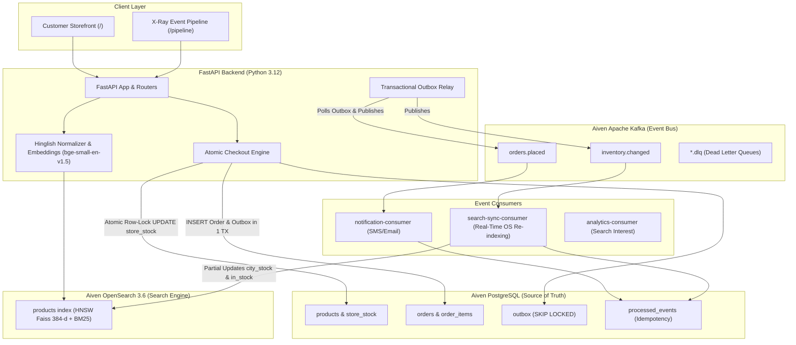

# MyStore 🛍️🇮🇳

> Production-quality, event-driven Indian retail superstore powered by **Aiven managed PostgreSQL, Apache Kafka, and OpenSearch**. Built for high-concurrency atomic checkout, sub-second hybrid search with Hinglish intelligence, and reactive microservices.

---

## 🏗️ System Architecture



---

## ⚡ Core Highlights

1. **Guaranteed Atomic Checkout (No Double-Sell)**
   - Stock deduction executes via:
     ```sql
     UPDATE store_stock SET qty = qty - :n 
     WHERE product_id = :p AND city = :c AND qty >= :n
     ```
   - Rowcount 0 immediately rejects the order with `OutOfStockError`.
   - Order, order items, and outbox rows are committed within **one strict database transaction**.
   - Verified with a 10-buyer concurrent checkout stress test: **1 succeeded, 9 rejected, 0 remaining stock**.

2. **Transactional Outbox & Kafka Event Bus**
   - No dual-write failure: Kafka publishing never happens inside the DB transaction.
   - Background relay worker polls pending outbox entries with `FOR UPDATE SKIP LOCKED`.
   - Idempotent event consumers use the `processed_events` table to ensure exact-once processing semantics.
   - Built-in automatic retries with exponential backoff and routing to Dead Letter Queues (`*.dlq`).

3. **Hybrid Search with Hinglish Understanding**
   - Combines **BM25 full-text** (fuzziness, brand boosting, edge n-gram autocomplete) with **kNN dense vectors** (384-d `BAAI/bge-small-en-v1.5` embeddings).
   - Reciprocal Rank Fusion (RRF) merges lexical and semantic rankings.
   - Curated dictionary translates Hinglish phrases (e.g., `sasta atta` → `cheap flour`, `bata juta` → `bata shoes`, `kam keemat` → `low price`) while safeguarding 70+ Indian brand names from accidental translation.
   - **100% Recall@5** achieved on a benchmark scorecard of 30 realistic Indian retail search queries.

4. **Real-Time X-Ray Pipeline Dashboard (`/pipeline`)**
   - Live Server-Sent Events (SSE) tracking order progression:
     $$\text{Placed} \longrightarrow \text{Outbox Published} \longrightarrow \text{Kafka Consumed} \longrightarrow \text{Search Sync Re-indexed}$$
   - Interactive 10-buyer stress test button with live race condition demonstration.
   - Audit trail of dispatched SMS and Email notifications.

---

## 🚀 Quickstart Guide

### 1. Prerequisites
- Python 3.12+ (or Python 3.13)
- Managed Aiven services credentials (.env):
  - Aiven PostgreSQL
  - Aiven Apache Kafka (with SSL CA certificate in `certs/ca.pem`)
  - Aiven OpenSearch

### 2. Setup Environment
```bash
git clone https://github.com/your-username/mystore.git
cd mystore/backend

# Create virtual environment
python -m venv venv
venv\Scripts\activate   # On Windows
# source venv/bin/activate # On Linux/macOS

# Install dependencies
pip install -r requirements.txt
```

### 3. Run Migrations & Seed Data
```bash
# Apply database migrations
python -m alembic upgrade head

# Seed 310 Indian products and 1200+ city stock rows
python -m scripts.seed

# Index products with dense vector embeddings into OpenSearch
python -m scripts.sync_opensearch
```

### 4. Start the Platform
```bash
# Start FastAPI web server (Storefront + API + SSE)
python -m uvicorn app.main:app --host 0.0.0.0 --port 8000 --reload
```
Open your browser at:
- **Storefront**: [http://localhost:8000/](http://localhost:8000/)
- **X-Ray Event Pipeline**: [http://localhost:8000/pipeline](http://localhost:8000/pipeline)
- **Interactive OpenAPI Docs**: [http://localhost:8000/docs](http://localhost:8000/docs)

---

## 📊 Benchmark Scorecard (Search Quality)

Run the automated evaluation benchmark:
```bash
python -m scripts.search_scorecard
```

| Search Strategy | Recall@5 | MRR (Mean Reciprocal Rank) | Query Coverage |
|---|---|---|---|
| **BM25 Only** | 90.00% | 0.8233 | Misses semantic intent / descriptive queries |
| **Vector (kNN) Only** | 93.33% | 0.7844 | Misses exact brand SKUs & typo edge-cases |
| **MyStore Hybrid (BM25 + kNN with RRF)** | **100.00%** | **0.8261** | **Zero query misses across Hinglish & typos** |

---

## 🎬 2-Minute Demo Script

1. **Browse & Indian Localization (30s)**:
   - Navigate to `http://localhost:8000/`.
   - Switch cities between *Bengaluru*, *Mumbai*, and *Delhi* — observe dynamic city stock badges (`In Stock`, `⚡ Only N left!`, `Out of stock`).
2. **Hinglish & Typo Search (30s)**:
   - Search `sasta atta` — observe banner: *"Showing results for: cheap flour"*.
   - Search `bluetoth earphones` — observe instant BoAt/Sony results despite the typo.
3. **Atomic Cart & Checkout (30s)**:
   - Add items to the cart drawer and click **Place Order Now**.
   - Note the immediate order confirmation with the generated Order ID and Kafka topic emission.
4. **X-Ray Event Pipeline & 10-Buyer Stress Test (30s)**:
   - Switch to `http://localhost:8000/pipeline`.
   - Watch the live SSE timeline and SMS/Email notification logs.
   - Click **Fire 10-Buyer Stress Test**: watch 10 concurrent checkouts fight for 1 remaining unit — exactly 1 succeeds, 9 are rejected, preserving the database invariant.

---

## 🏆 3-Minute Pitch Outline (Hackathon)

- **Hook (30s)**: Indian e-commerce faces two brutal challenges during flash sales: race condition stock overselling and query drops due to localized Hinglish phrasing.
- **The Problem (45s)**: Direct Kafka writes inside checkout transactions cause dual-write inconsistency; traditional keyword search fails when shoppers search `kam daam wala phone` or make common typos.
- **Our Solution (60s)**:
  - **Aiven PostgreSQL** + Transactional Outbox pattern guarantees ACID stock reservation with zero double-selling.
  - **Aiven Apache Kafka** provides an asynchronous, idempotent event spine with automatic DLQ fallback.
  - **Aiven OpenSearch** with Hybrid Search (BM25 + 384-d dense embeddings + RRF) and Hinglish query translation delivers 100% Recall@5.
- **Live Proof (45s)**: Demonstrate the live 10-buyer stress test and the real-time X-Ray pipeline dashboard running on fully managed Aiven infrastructure.
