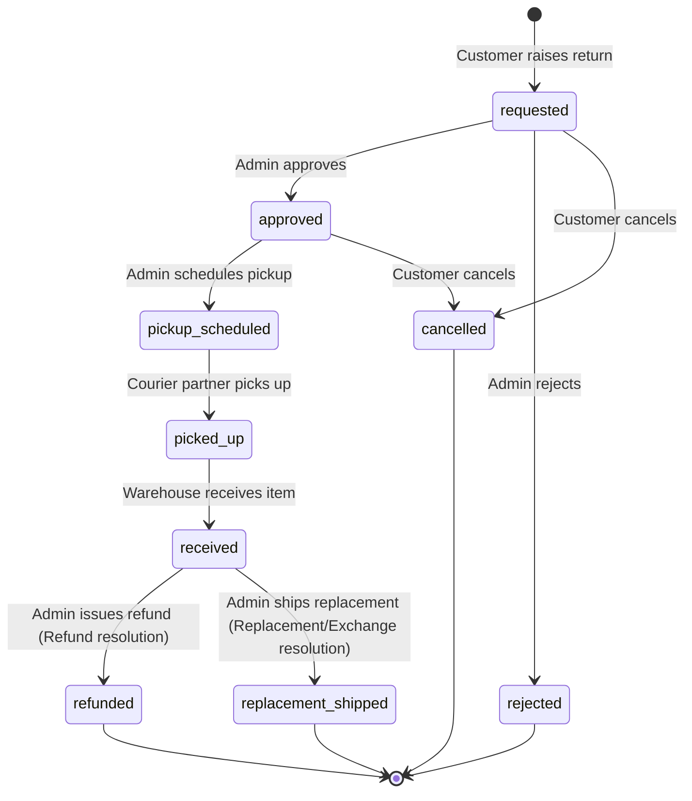

# Post-Delivery Returns & Reverse Logistics

## 1. Overview
MyStore / NammaStore provides an end-to-end, event-driven reverse logistics and returns management platform. Once an order is delivered to a customer, items become eligible for return, replacement, or exchange based on category policies, condition, and strict return windows.

Every state transition is transactional: state updates, inventory adjustments, and outbox event publishing commit in a single atomic database transaction, ensuring zero loss of events and preventing double-refunds or double-returns.

---

## 2. Order Delivery Lifecycle & Eligibility Rules
An order follows the sequential delivery lifecycle:
```text
placed -> shipped -> out_for_delivery -> delivered
```
Only orders in status `delivered` are eligible for return requests. Upon setting an order to `delivered`, `delivered_at` is stamped with the current UTC timestamp.

### Return Windows by Category
| Category | Return Window | Allowed Reasons | Allowed Resolutions |
| :--- | :--- | :--- | :--- |
| **Fashion** | 10 days | Defective, Damaged in Transit, Wrong Item, Not as Described, Size/Fit | Refund, Replacement, Exchange |
| **Electronics** | 7 days | Defective, Damaged in Transit, Wrong Item, Not as Described | Refund, Replacement |
| **Mobiles** | 7 days | Defective, Damaged in Transit, Wrong Item, Not as Described | Refund, Replacement |
| **Appliances** | 7 days | Defective, Damaged in Transit, Wrong Item, Not as Described | Refund, Replacement |
| **Beauty** | 3 days | Damaged in Transit, Wrong Item | Refund Only |
| **Food & Health** | 3 days | Damaged in Transit, Wrong Item | Refund Only |

### Proof Photo Requirements
- Reasons `defective`, `damaged_in_transit`, `wrong_item`, and `not_as_described` require **1 to 3 JPEG/PNG/WebP photos** (max 2 MB per file).
- Reason `size_fit` (Fashion only) does not require photos.
- Photos are uploaded via `POST /api/returns/uploads` and stored at `/static/uploads/returns/<uuid>.<ext>`.

---

## 3. Reverse Logistics State Machine
Return transitions follow an audited state machine:



### Concurrency & Guardrails
1. **Row-Level Order Item Locking**: `SELECT ... FOR UPDATE` is held on `order_items` during return creation to calculate remaining returnable quantity (`quantity - non_cancelled_non_rejected_returns`). Concurrent requests exceeding returnable quantity are rejected with `HTTP 400`.
2. **Guarded State Transitions**: Transitions execute with `UPDATE return_requests SET status = :new WHERE id = :id AND status = :expected`. A rowcount of 0 triggers `HTTP 409 Conflict`.
3. **Inventory Restocking**:
   - On warehouse receipt (`mark_received`), admin specifies `item_condition` (`resellable` or `damaged`).
   - If `resellable`: `UPDATE store_stock SET qty = qty + :q WHERE product_id = :p AND city = :city`. An `inventory.changed` event is written to the transactional outbox to re-sync OpenSearch.
4. **Replacement Inventory Guardrail**:
   - On `ship_replacement`, stock is decremented atomically: `UPDATE store_stock SET qty = qty - :qty WHERE product_id = :p AND city = :city AND qty >= :qty`.
   - If stock is insufficient, the endpoint returns `HTTP 409 {"error": "REPLACEMENT_UNAVAILABLE"}`, and the return remains in `received` so admin can issue a refund instead.

---

## 4. API Reference

### Customer Endpoints
- `GET /api/orders?customer_id=`: List orders with item-level return eligibility, deadlines, and active return requests.
- `GET /api/returns/policy`: Business rules, categories, reasons, resolutions, and transitions.
- `POST /api/returns/uploads`: Upload proof images (`multipart/form-data`, max 2MB).
- `POST /api/orders/{order_id}/returns`: Create a return request (`201 Created`).
- `GET /api/returns?customer_id=&order_id=`: List returns with summary.
- `GET /api/returns/{id}`: Detailed return request with status history timeline.
- `POST /api/returns/{id}/cancel`: Customer cancellation from `requested` or `approved`.

### Admin Endpoints (Require `X-Admin-Key` header)
- `GET /api/admin/returns?status=`: List all return requests across customers with product and order data.
- `POST /api/admin/returns/{id}/transition`: Transition status (`action`: `approve`, `reject`, `schedule_pickup`, `mark_picked_up`, `mark_received`, `issue_refund`, `ship_replacement`).

### Dev & Analytics Endpoints
- `POST /dev/orders/{order_id}/advance`: Advance delivery lifecycle for rapid testing (`disabled in production`).
- `GET /api/returns/stats`: Real-time return metrics, breakdown by status, top 5 reasons, and Try-On vs Non-Try-On return rate comparison.

---

## 5. Kafka Event Bus & Consumers
1. **Topic `returns.events`**:
   - Emits events on every state change: `return.requested`, `return.approved`, `return.rejected`, `return.pickup_scheduled`, `return.picked_up`, `return.received`, `return.refunded`, `refund.issued`, `return.replacement_shipped`, `return.cancelled`.
   - Matching Dead Letter Queue: `returns.events.dlq`.
2. **Consumer `returns_notification_consumer.py`**:
   - Idempotent consumer (group: `mystore-returns-notification-group`).
   - Inserts SMS and Email notifications into PostgreSQL `notifications` table for live UI tracking.
   - Deduped via `processed_events` table using `event_id`.

---

## 6. Portals & User Interfaces
- **Storefront Customer Portal**: Click `My Orders` in header to view orders, advance delivery in dev mode, raise returns with photo previews, and track timelines.
- **Admin Returns Operations**: Access `/admin/returns` to review incoming requests, schedule pickups, perform warehouse inspections, restock resellable items, and trigger refunds/replacements.
- **X-Ray Pipeline Dashboard**: Access `/pipeline` to monitor Kafka event streams, outbox throughput, and Try-On return rate reduction analytics.
